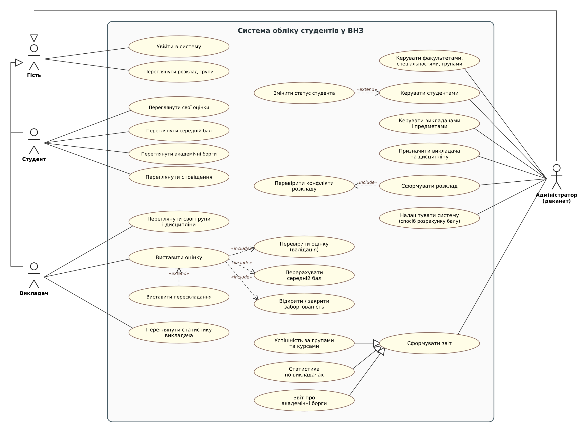

# Система обліку студентів у ВНЗ

Курсова робота з дисципліни «Документування програмного забезпечення та шаблони проектування».
**Проєкт 16.** Виконала: Маліш Вікторія, група ІР-43, НУ «Львівська політехніка».

Веб-додаток для обліку студентів і їхніх навчальних досягнень: студенти, викладачі, предмети,
оцінки за заліки та іспити, автоматичний розрахунок середнього балу, академічні заборгованості,
розклад занять і звіти.

> 🚧 Проєкт у розробці. Поточний стан і план – у [`docs/ROADMAP.md`](docs/ROADMAP.md).

## Технологічний стек

| Частина | Технології |
|---|---|
| Бекенд | Java 17, Spring Boot 3 (Web, Data JPA, Validation, Security), JWT |
| База даних | PostgreSQL 16, міграції Flyway |
| Фронтенд | React, TypeScript, Vite |
| Документація API | OpenAPI 3 / Swagger UI (springdoc) |
| Інфраструктура | Docker, Docker Compose, Maven |

## Документація

- [Аналіз предметної області та вимоги](docs/01-domain-analysis.md)
- [Use Case діаграма](docs/diagrams/use-case.png) (джерело PlantUML: [`use-case.puml`](docs/diagrams/use-case.puml))
- [Діаграма класів, GoF-шаблони та модель даних](docs/02-class-diagram.md)
- [ER-діаграма бази даних](docs/diagrams/er-diagram.png)
- [Реалізація шаблонів проектування](docs/design-patterns.md): діаграми послідовності
  «виставлення оцінки» і «формування звіту», діаграма станів студента
- [REST API, безпека та звіти](docs/04-rest-api.md): ролі, ресурси, формат помилок, приклади запитів



## Швидкий старт (поточний етап)

Потрібно: JDK 17+, Maven 3.9+, Docker.

```bash
# 1. Запустити PostgreSQL
cp .env.example .env
docker compose up -d db

# 2. Запустити бекенд
cd backend
mvn spring-boot:run
```

Бекенд стартує на `http://localhost:8080`. Під час першого запуску Flyway створить схему БД
і завантажить демонстраційні дані (облікові записи – у [`docs/02-class-diagram.md`](docs/02-class-diagram.md#демонстраційні-облікові-записи)).

REST API документовано в Swagger UI: **http://localhost:8080/swagger-ui.html**. Щоб викликати захищені
операції, виконайте `POST /api/auth/login` (напр. `admin` / `admin123`), натисніть **Authorize** і
вставте отриманий токен. Короткий приклад з командного рядка:

```bash
TOKEN=$(curl -s -X POST http://localhost:8080/api/auth/login -H 'Content-Type: application/json' \
        -d '{"username":"admin","password":"admin123"}' | sed -E 's/.*"token":"([^"]+)".*/\1/')
curl -s http://localhost:8080/api/reports/group-performance -H "Authorization: Bearer $TOKEN"
```

## Тести

```bash
cd backend
mvn test
```

Модульні тести GoF-шаблонів і сервісів (JUnit 5 + Mockito) не потребують бази даних;
тести REST API (`@WebMvcTest`, `@SpringBootTest` з MockMvc) виконуються на вбудованій H2 (профіль `test`).
