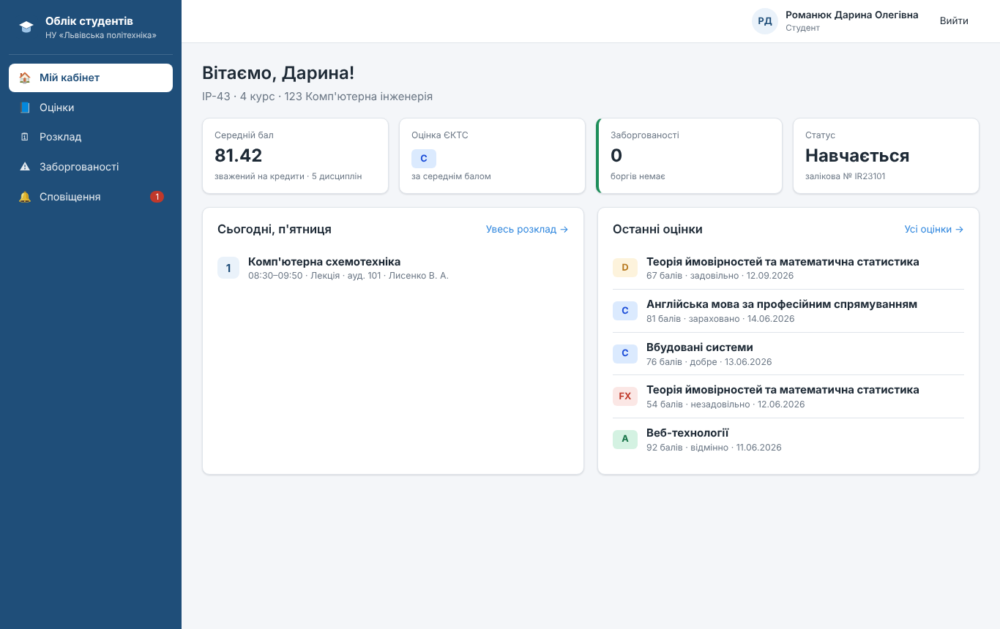
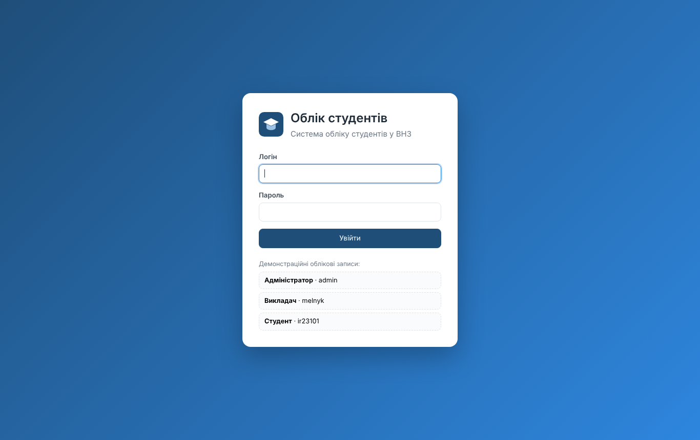
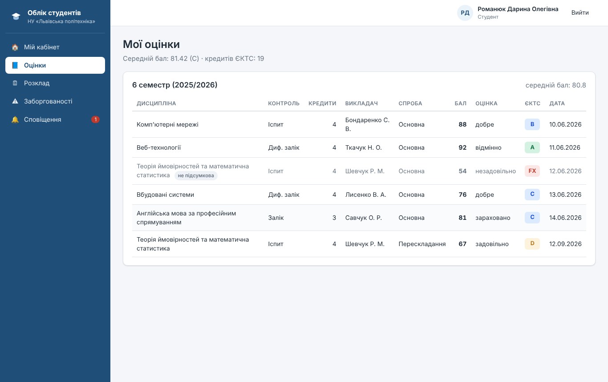
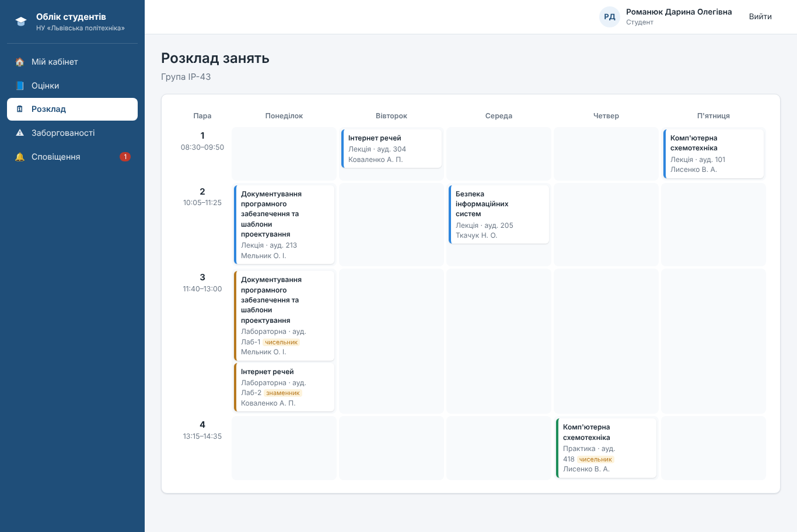
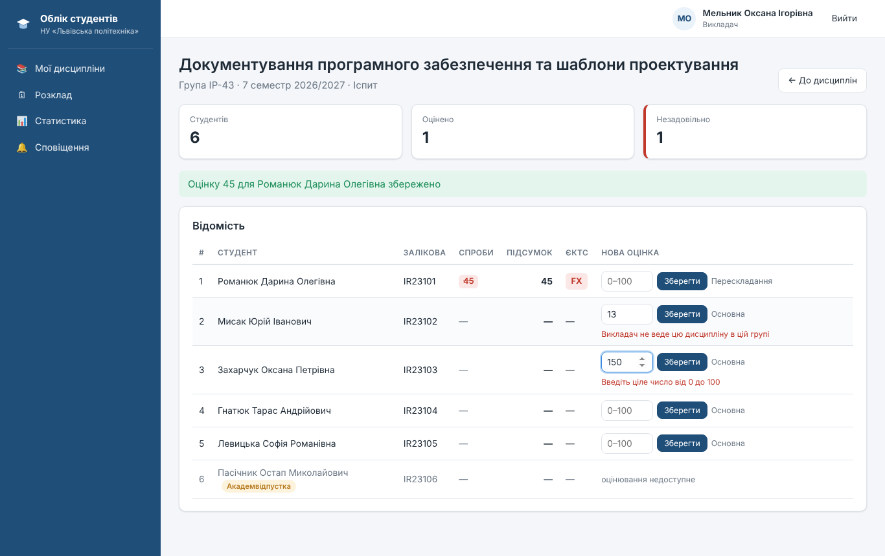
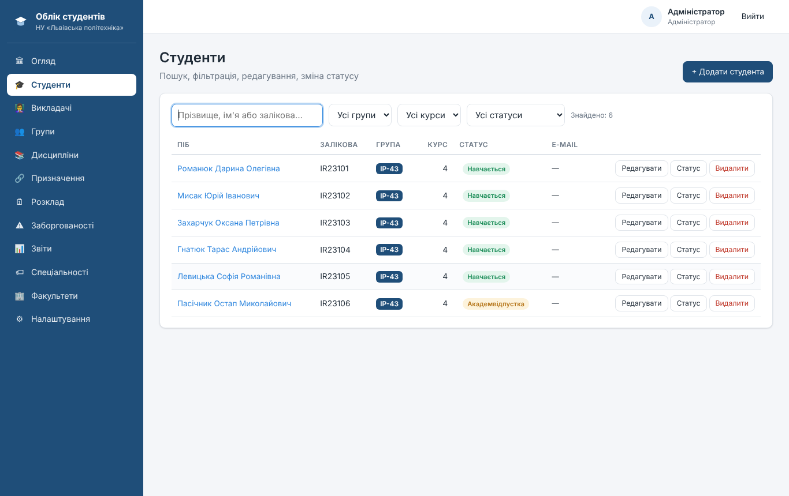
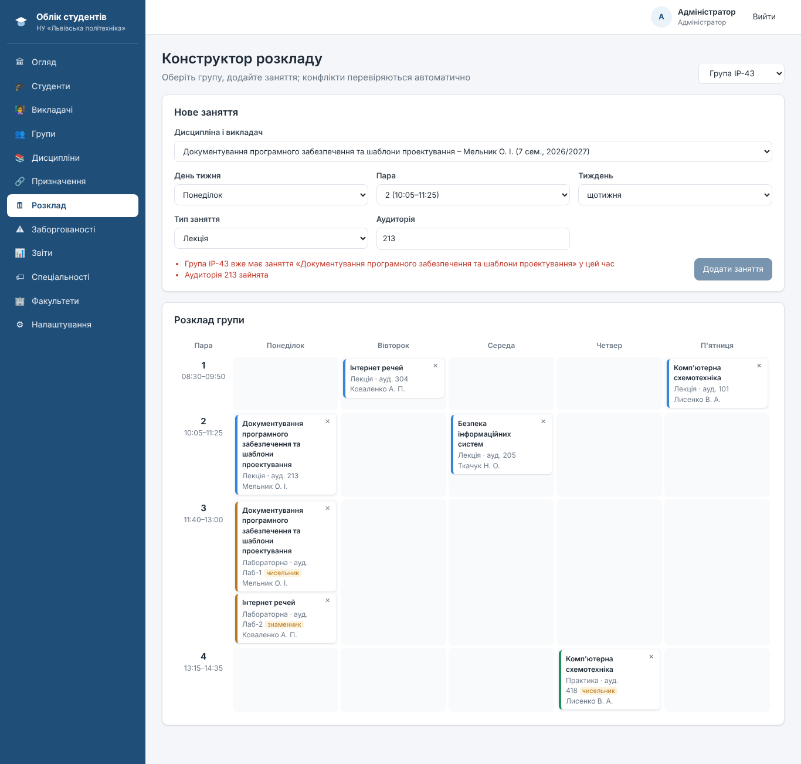
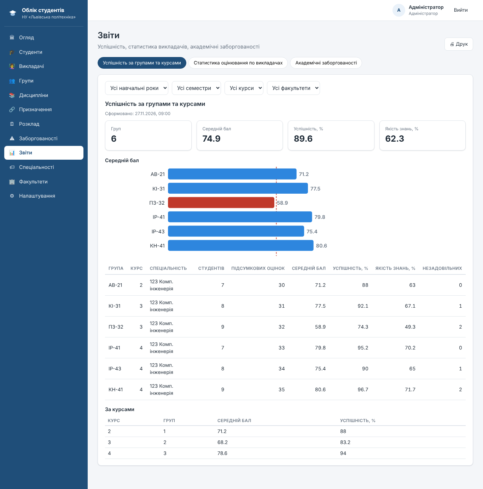

# Система обліку студентів у ВНЗ

Курсова робота з дисципліни «Документування програмного забезпечення та шаблони проектування».
**Проєкт 16.** Виконала: Маліш Вікторія, група ІР-43, НУ «Львівська політехніка».

Веб-додаток для обліку студентів і їхніх навчальних досягнень: студенти, викладачі, дисципліни,
оцінки за заліки та іспити з перескладаннями, автоматичний розрахунок середнього балу, академічні
заборгованості, розклад занять, сповіщення і звіти. У системі застосовано **9 шаблонів проектування GoF**.



## Можливості

| Роль | Що може |
|---|---|
| **Студент** | бачить свої оцінки за семестрами (100-бальна, національна шкала, ЄКТС), середній бал, академічні заборгованості, розклад, отримує сповіщення про нові оцінки |
| **Викладач** | бачить свої дисципліни й відомості груп, виставляє оцінки та перескладання (основна → викладачу → комісії), переглядає свій розклад і статистику оцінювання |
| **Адміністратор (деканат)** | керує довідниками, студентами (зокрема зміна статусу), викладачами, призначеннями; формує розклад з автоматичною перевіркою конфліктів; переглядає борги й звіти; обирає спосіб розрахунку середнього балу |

## Шаблони проектування

| Шаблон | Для чого | Класи |
|---|---|---|
| Singleton | єдина шкала оцінювання (бали → національна шкала → ЄКТС) | `GradingScale` |
| Strategy | спосіб розрахунку середнього балу (простий / зважений на кредити) | `GpaCalculationStrategy`, `SimpleAverageStrategy`, `CreditWeightedStrategy` |
| State | поведінка студента залежно від статусу, дозволені переходи | `StudentState`, `ActiveState`, `AcademicLeaveState`, `ExpelledState`, `GraduatedState` |
| Chain of Responsibility | перевірки перед виставленням оцінки | `GradeValidationHandler`, `ScoreRangeHandler`, `StudentActiveHandler`, `TeacherOwnsAssignmentHandler`, `AttemptLimitHandler` |
| Observer | реакція на нову оцінку: борг, сповіщення, середній бал | `GradeEventPublisher`, `AcademicDebtObserver`, `NotificationObserver`, `GpaRecalculationObserver` |
| Facade | картка студента одним викликом | `StudentRecordFacade` |
| Template Method | єдиний алгоритм формування звітів | `AbstractReportGenerator` та 3 генератори |
| Factory Method | вибір генератора звіту за типом | `ReportGeneratorFactory` |
| Builder | покрокова побудова незмінного звіту | `Report.Builder` |

Детально – у [`docs/design-patterns.md`](docs/design-patterns.md) (з діаграмами послідовності та станів).

## Технологічний стек

| Частина | Технології |
|---|---|
| Бекенд | Java 17, Spring Boot 3 (Web, Data JPA, Validation, Security), JWT |
| База даних | PostgreSQL 16, міграції Flyway |
| Фронтенд | React 19, TypeScript, Vite |
| Документація API | OpenAPI 3 / Swagger UI (springdoc) |
| Тести | JUnit 5, Mockito, AssertJ, MockMvc, H2, PostgreSQL у CI |
| Інфраструктура | Docker, Docker Compose, nginx, GitHub Actions |

## Документація

1. [Аналіз предметної області та вимоги](docs/01-domain-analysis.md), [Use Case діаграма](docs/diagrams/use-case.png)
2. [Діаграма класів, GoF-шаблони та модель даних](docs/02-class-diagram.md), [ER-діаграма](docs/diagrams/er-diagram.png)
3. [Архітектура, GRASP і SOLID, тестування, розгортання](docs/03-architecture.md)
4. [REST API, безпека та звіти](docs/04-rest-api.md)
5. [Реалізація шаблонів проектування](docs/design-patterns.md)
6. [Клієнтська частина (React)](docs/frontend.md)
7. [План розробки](docs/ROADMAP.md)

## Запуск

### Варіант 1 – Docker (рекомендовано)

Потрібен лише Docker.

```bash
cp .env.example .env      # за потреби змініть паролі та JWT_SECRET
docker compose up --build
```

| Сервіс | Адреса |
|---|---|
| Веб-інтерфейс | **http://localhost:3000** |
| REST API | http://localhost:8080/api |
| Swagger UI | http://localhost:8080/swagger-ui.html |

Під час першого запуску створюється схема БД і завантажуються демонстраційні дані.

### Варіант 2 – локально для розробки

Потрібно: JDK 17+, Maven 3.9+, Node.js 20+, Docker (лише для PostgreSQL).

```bash
# 1. PostgreSQL
docker compose up -d db

# 2. Бекенд (http://localhost:8080)
cd backend
mvn spring-boot:run

# 3. Фронтенд (http://localhost:5173), в іншому терміналі
cd frontend
npm install
npm run dev
```

## Демо-доступ

| Роль | Логін | Пароль |
|---|---|---|
| Адміністратор | `admin` | `admin123` |
| Викладач | `melnyk` (також `kovalenko`, `bondarenko`, `tkachuk`, `shevchuk`, `kravets`, `lysenko`, `savchuk`) | `teacher123` |
| Студент | `ir23101` (номер залікової книжки в нижньому регістрі) | `student123` |

На сторінці входу є кнопки-підказки з цими обліковими записами.

## Інтерфейс

| | |
|---|---|
|  |  |
| Вхід у систему | Оцінки студента за семестрами |
|  |  |
| Розклад (чисельник / знаменник) | Відомість викладача: оцінки, перескладання, помилки валідації |
|  |  |
| Адмін-панель: студенти | Конструктор розкладу з перевіркою конфліктів |
|  | |
| Звіти з діаграмами | |

## Тести

```bash
cd backend && mvn verify          # модульні тести + тести API (H2)
cd frontend && npm run build      # перевірка типів TypeScript і збірка
```

Інтеграційні тести на PostgreSQL (міграції та наскрізні сценарії на демо-даних) запускаються, коли
задано змінну `CI_POSTGRES=true` і доступна БД – так їх виконує GitHub Actions на кожен push і pull request.

## Структура репозиторію

```
.
├── backend/                 Spring Boot: REST API, бізнес-логіка, шаблони GoF
│   ├── src/main/java/ua/lpnu/studentrecords
│   │   ├── domain/          сутності, перелічення, винятки
│   │   ├── repository/      Spring Data JPA
│   │   ├── pattern/         strategy, state, chain, observer, facade, report, scale
│   │   ├── service/         сценарії використання
│   │   ├── security/        JWT, ролі, доступ до даних
│   │   └── web/             контролери, DTO, мапери, обробка помилок
│   ├── src/main/resources/db/migration   міграції Flyway
│   └── Dockerfile
├── frontend/                React + TypeScript (Vite), nginx.conf, Dockerfile
├── docs/                    документація, діаграми, скріни
├── docker-compose.yml       db + backend + frontend
└── .github/workflows/ci.yml GitHub Actions
```
