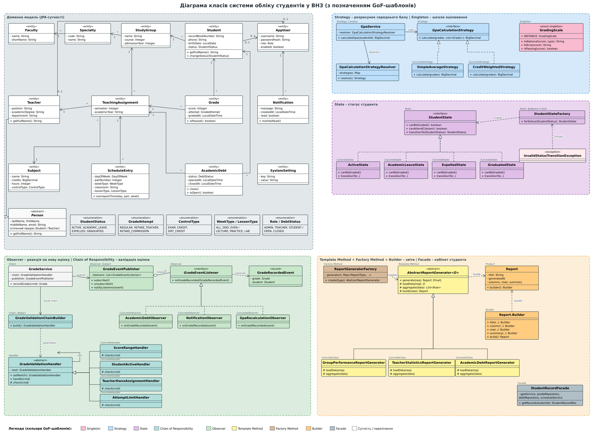
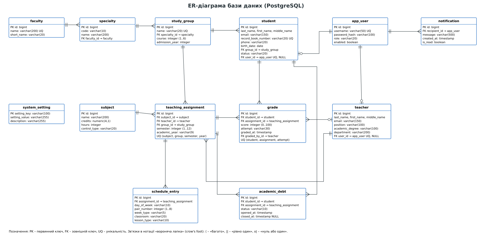

# 2. Діаграма класів і модель даних

## 2.1. Діаграма класів системи в цілому

Діаграма поділена на п'ять логічних блоків. Кольором позначено, до якого GoF-шаблону належить клас
(легенда внизу діаграми, кольори узгоджені з Додатком В методичних вказівок):

| Колір | Шаблон | Класи |
|---|---|---|
| рожевий | **Singleton** | `GradingScale` |
| блакитний | **Strategy** | `GpaService`, `GpaCalculationStrategy`, `SimpleAverageStrategy`, `CreditWeightedStrategy`, `GpaCalculationStrategyResolver` |
| фіолетовий | **State** | `StudentState`, `ActiveState`, `AcademicLeaveState`, `ExpelledState`, `GraduatedState`, `StudentStateFactory` |
| бірюзовий | **Chain of Responsibility** | `GradeValidationHandler`, `ScoreRangeHandler`, `StudentActiveHandler`, `TeacherOwnsAssignmentHandler`, `AttemptLimitHandler`, `GradeValidationChainBuilder` |
| зелений | **Observer** | `GradeEventPublisher`, `GradeEventListener`, `AcademicDebtObserver`, `NotificationObserver`, `GpaRecalculationObserver`, `GradeRecordedEvent` |
| жовтий | **Template Method** | `AbstractReportGenerator`, `GroupPerformanceReportGenerator`, `TeacherStatisticsReportGenerator`, `AcademicDebtReportGenerator` |
| коричневий | **Factory Method** | `ReportGeneratorFactory` |
| оранжевий | **Builder** | `Report`, `Report.Builder` |
| сіро-синій | **Facade** | `StudentRecordFacade` |

### Доменна модель

Центральна сутність – **`TeachingAssignment`** (призначення викладача): дисципліна (`Subject`), яку
викладач (`Teacher`) веде в групі (`StudyGroup`) у певному семестрі навчального року. До призначення
прив'язані оцінки (`Grade`), академічні заборгованості (`AcademicDebt`) і заняття в розкладі
(`ScheduleEntry`). Завдяки цьому одна дисципліна може викладатися різними викладачами в різних групах,
а оцінки та статистика завжди мають однозначний контекст «хто, кому, що, коли».

Ієрархія навчального закладу: `Faculty` 1 → * `Specialty` 1 → * `StudyGroup` 1 → * `Student`.
`Student` і `Teacher` успадковують абстрактний клас `Person` (спільні ПІБ і e-mail, методи
`getFullName()`, `getShortName()`). Обліковий запис для входу (`AppUser`, роль ADMIN / TEACHER /
STUDENT) відокремлений від персональних даних і пов'язаний із студентом або викладачем зв'язком 0..1 – 0..1.

Логіка, яка належить даним, розміщена в самих сутностях (GRASP **Information Expert**):
`Grade.isPassed()`, `AcademicDebt.close()`, `ScheduleEntry.overlapsInTime(...)`,
`GradeAttempt.next()`, `WeekType.overlaps(...)`.

### Як шаблони працюють разом (сценарій «викладач виставляє оцінку»)

1. `GradeService.recordGrade(cmd)` передає команду в ланцюжок валідації (**Chain of Responsibility**),
   який зібрав `GradeValidationChainBuilder`: діапазон балів → студент може бути оцінений → викладач веде
   цю дисципліну → дозволена спроба (основна / перескладання викладачу / комісії).
2. Перевірка «студент може бути оцінений» делегується поточному стану студента (**State**):
   `StudentStateFactory.forStatus(status).canBeGraded()` – відрахованому чи випускнику оцінку не виставити.
3. Оцінка зберігається, і `GradeEventPublisher` сповіщає всіх підписників (**Observer**):
   `AcademicDebtObserver` відкриває або закриває заборгованість, `NotificationObserver` створює сповіщення
   студенту, `GpaRecalculationObserver` перераховує середній бал.
4. Середній бал рахує `GpaService` за допомогою стратегії (**Strategy**), яку
   `GpaCalculationStrategyResolver` обирає за налаштуванням `gpa.strategy` (просте середнє або зважене на
   кредити ЄКТС). Переведення балів у національну шкалу та ЄКТС виконує єдиний екземпляр
   `GradingScale` (**Singleton**).
5. Кабінет студента отримує все одним викликом `StudentRecordFacade.getRecord(id)` (**Facade**):
   оцінки + середній бал + борги + розклад.

Детальний опис реалізації кожного шаблону, діаграма послідовності цього сценарію та діаграма станів
студента – у документі [«Реалізація шаблонів проектування»](design-patterns.md).

### Звіти

`ReportGeneratorFactory` (**Factory Method**) за типом звіту повертає потрібний генератор.
`AbstractReportGenerator.generate()` (**Template Method**) – незмінний алгоритм
«завантажити дані → агрегувати → побудувати звіт», де кроки `loadData` і `aggregate` перевизначають
підкласи: успішність за групами та курсами, статистика по викладачах, академічні борги.
Результат будується через `Report.Builder` (**Builder**) – незмінний об'єкт `Report` із заголовком,
колонками, рядками та підсумками.

## 2.2. ER-діаграма бази даних

Схема створюється міграціями Flyway:

- `V1__init_schema.sql` – 13 таблиць, зовнішні ключі, обмеження `CHECK` (діапазон балів 0–100, курс 1–6,
  пара 1–8, допустимі значення перелічень), унікальність (номер залікової книжки, одна оцінка на спробу,
  одне призначення дисципліни групі на семестр) та індекси для частих запитів;
- `V2__seed_data.sql` – демонстраційні дані: 2 інститути, 4 спеціальності, 6 груп (зокрема ІР-43),
  43 студенти, 8 викладачів, 12 дисциплін, оцінки за минулий семестр із незадовільними результатами,
  відкриті й закриті заборгованості, розклад поточного семестру без конфліктів.

Hibernate працює в режимі `ddl-auto: validate` – під час старту перевіряє, що JPA-сутності точно
відповідають схемі, створеній міграціями. У CI ця перевірка виконується на справжній PostgreSQL
(`DatabaseMigrationTest`).

### Демонстраційні облікові записи

| Роль | Логін | Пароль |
|---|---|---|
| Адміністратор | `admin` | `admin123` |
| Викладач | `kovalenko`, `melnyk`, `bondarenko`, `tkachuk`, `shevchuk`, `kravets`, `lysenko`, `savchuk` | `teacher123` |
| Студент | номер залікової книжки в нижньому регістрі, напр. `ir23101` | `student123` |
