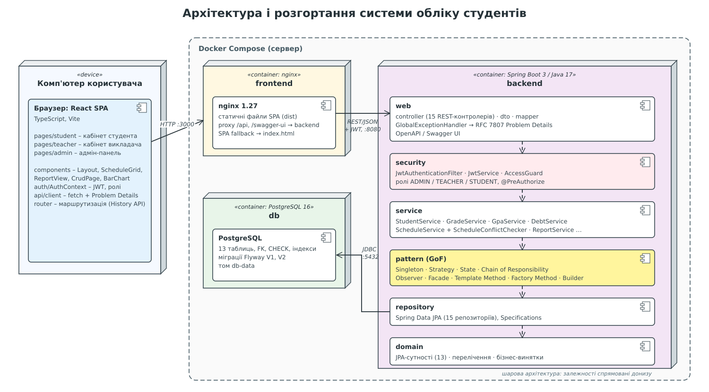

# 3. Архітектура системи



## 3.1. Загальна схема

Система побудована за архітектурою **клієнт–сервер** з трьома незалежними компонентами, кожен у своєму
Docker-контейнері:

| Компонент | Технології | Відповідальність |
|---|---|---|
| **frontend** | React 19, TypeScript, Vite, nginx | односторінковий веб-інтерфейс (SPA) для трьох ролей; nginx роздає статичні файли та проксіює `/api` на бекенд |
| **backend** | Java 17, Spring Boot 3 (Web, Data JPA, Validation, Security), JWT, springdoc-openapi | REST API, бізнес-логіка, GoF-шаблони, безпека, звіти |
| **db** | PostgreSQL 16, Flyway | зберігання даних; схема версіонується міграціями |

Клієнт і сервер взаємодіють лише через **REST API у форматі JSON** (див. [`04-rest-api.md`](04-rest-api.md)).
Автентифікація – stateless, за **JWT-токеном** у заголовку `Authorization: Bearer …`. Помилки
повертаються в єдиному форматі **RFC 7807 Problem Details**.

## 3.2. Шари бекенду

Бекенд організовано як **шарову архітектуру**: кожен шар залежить лише від шарів, що нижче.

| Шар (пакет) | Призначення | Приклади класів |
|---|---|---|
| `web` | REST-контролери, DTO (Java records), мапери сутність ↔ DTO, обробка помилок | `StudentController`, `GradeController`, `ReportController`, `AcademicMapper`, `GlobalExceptionHandler` |
| `security` | JWT, автентифікація, перевірки доступу до даних | `JwtService`, `JwtAuthenticationFilter`, `AccessGuard`, `SecurityConfig` |
| `service` | сценарії використання (use cases), транзакції | `StudentService`, `GradeService`, `GpaService`, `DebtService`, `ScheduleService`, `ReportService` |
| `pattern` | реалізації GoF-шаблонів, які використовують сервіси | `pattern.strategy`, `pattern.state`, `pattern.chain`, `pattern.observer`, `pattern.report`, `pattern.facade`, `pattern.scale` |
| `repository` | доступ до даних (Spring Data JPA), динамічні запити | `StudentRepository`, `GradeRepository`, `StudentSpecifications` |
| `domain` | JPA-сутності, перелічення, бізнес-винятки | `Student`, `Grade`, `TeachingAssignment`, `StudentStatus`, `GradeValidationException` |

Дані проходять шлях **HTTP-запит → контролер (валідація DTO) → сервіс (транзакція, бізнес-правила,
шаблони) → репозиторій → БД**, а назад сутності перетворюються в DTO – сутності JPA ніколи не
віддаються назовні напряму.

## 3.3. Клієнтська частина

Структура фронтенду описана в [`frontend.md`](frontend.md). Коротко:
- `api/client.ts` – єдина точка звернення до сервера (токен, обробка помилок);
- `auth/AuthContext.tsx` – стан користувача, відновлення сесії, вихід при `401`;
- `pages/student`, `pages/teacher`, `pages/admin` – сторінки для кожної ролі;
- `components` – повторно використовувані компоненти (`ScheduleGrid`, `ReportView`, `CrudPage`, `BarChart`).

## 3.4. Застосування принципів GRASP

| Принцип | Де застосовано |
|---|---|
| **Information Expert** (інформаційний експерт) | Обов'язок покладено на клас, що має потрібні дані: `Grade.isPassed()`, `AcademicDebt.close()`, `ScheduleEntry.overlapsInTime()`, `Student.canBeGraded()`, `GradeAttempt.next()`, `WeekType.overlaps()`. |
| **Creator** (творець) | Об'єкти створює клас, який їх агрегує або має дані для ініціалізації: `GradeService` створює `Grade`, `AcademicDebtObserver` – `AcademicDebt`, `NotificationObserver` – `Notification`, `Report.Builder` – `Report`. |
| **Controller** (контролер) | Системні події (HTTP-запити) приймають REST-контролери `web.controller.*`, які лише делегують сервісам і не містять бізнес-логіки. |
| **Low Coupling** (низька зв'язаність) | `GradeService` не знає про заборгованості, сповіщення і середній бал – лише про `GradeEventPublisher` (Observer). Контролер звітів не знає конкретних генераторів – лише `ReportGeneratorFactory`. |
| **High Cohesion** (високе зчеплення) | Кожен клас має одну вузьку задачу: `ScheduleConflictChecker` – лише конфлікти розкладу, `GpaService` – лише середній бал, `JwtService` – лише токени. |
| **Polymorphism** (поліморфізм) | Варіанти поведінки – через поліморфні класи замість умов: стратегії середнього балу, стани студента, обробники ланцюжка валідації, генератори звітів. |
| **Pure Fabrication** (чиста вигадка) | Службові класи без аналога в предметній області: репозиторії, `AcademicMapper`, `ReportStatistics`, `GradeValidationChainBuilder`, `AccessGuard`. |
| **Indirection** (перенаправлення) | `GradeEventPublisher` стоїть між сервісом оцінок і спостерігачами; `GpaCalculationStrategyResolver` – між `GpaService` і конкретною стратегією. |
| **Protected Variations** (захищені зміни) | Точки ймовірних змін закрито інтерфейсами: `GpaCalculationStrategy`, `StudentState`, `GradeEventListener`, `AbstractReportGenerator`. |

## 3.5. Застосування принципів SOLID

| Принцип | Приклад |
|---|---|
| **S** – єдиної відповідальності | `GradeService` координує виставлення оцінки, а перевірки (`*Handler`), реакції на оцінку (`*Observer`) і розрахунок балу (`GpaService`) винесено в окремі класи. |
| **O** – відкритості/закритості | Новий спосіб розрахунку середнього балу, новий спостерігач чи новий звіт додається **новим класом-бином** без зміни наявного коду: Spring сам передає всі реалізації в `GpaCalculationStrategyResolver`, `GradeEventPublisher`, `ReportGeneratorFactory`. |
| **L** – підстановки Лісков | Будь-яку стратегію (`SimpleAverageStrategy`, `CreditWeightedStrategy`), будь-який стан студента чи генератор звіту можна підставити замість базового типу без зміни поведінки клієнта. |
| **I** – розділення інтерфейсів | Вузькі інтерфейси: `GradeEventListener` має один метод `onGradeRecorded`, `GpaCalculationStrategy` – `calculate`, репозиторії – лише потрібні запити. |
| **D** – інверсії залежностей | Сервіси залежать від абстракцій (інтерфейси репозиторіїв Spring Data, `GpaCalculationStrategy`, `GradeEventListener`), а конкретні реалізації впроваджує контейнер Spring через конструктор. |

## 3.6. Безпека

- Паролі зберігаються лише як **bcrypt-хеші**.
- Після входу (`POST /api/auth/login`) видається JWT з ідентифікатором користувача і роллю; термін дії – 8 годин.
- Доступ до операцій обмежено ролями (`@PreAuthorize("hasRole('ADMIN')")` тощо), а доступ до даних
  конкретного студента чи дисципліни – компонентом `AccessGuard` (`@access.canViewStudent(#id)`):
  студент бачить лише себе, викладач – лише свої дисципліни.
- CORS дозволено лише для адрес фронтенду (`CORS_ORIGINS`).

## 3.7. Тестування

| Рівень | Що перевіряється | Інструменти |
|---|---|---|
| Модульні тести | кожен GoF-шаблон, доменна модель, сервіси | JUnit 5, Mockito, AssertJ |
| Тести контролерів | валідація, коди відповідей, формат помилок | `@WebMvcTest`, MockMvc |
| Тести API з повним контекстом | JWT, ролі, доступ лише до власних даних, реакція шаблонів на запити | `@SpringBootTest`, H2 (профіль `test`) |
| Інтеграційні тести на PostgreSQL | міграції Flyway, відповідність сутностей схемі, наскрізні сценарії на демо-даних (вхід, оцінка з перескладанням, звіти, розклад без конфліктів) | `@DataJpaTest`, `@SpringBootTest`, PostgreSQL у GitHub Actions |
| Фронтенд | перевірка типів TypeScript, продакшн-збірка | `tsc`, Vite |

Усі тести запускаються в **GitHub Actions** на кожен push і pull request (`.github/workflows/ci.yml`):
job `backend` (Maven + PostgreSQL), `frontend` (TypeScript + Vite) і `docker` (збірка образів).

## 3.8. Розгортання

```bash
docker compose up --build
```

| Сервіс | Адреса |
|---|---|
| Веб-інтерфейс | http://localhost:3000 |
| REST API | http://localhost:8080/api |
| Swagger UI | http://localhost:8080/swagger-ui.html |
| PostgreSQL | localhost:5432 |

Під час першого запуску бекенд застосовує міграції Flyway і завантажує демонстраційні дані.
Секрет для підпису JWT задається змінною `JWT_SECRET` (див. `.env.example`).
