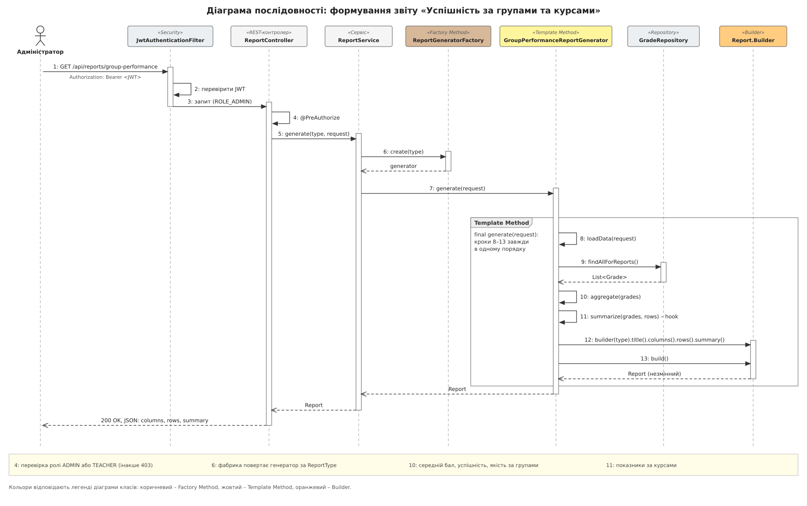

# 4. REST API, безпека та звіти

Документ описує програмний інтерфейс бекенду (етап 4): автентифікацію, права ролей, ресурси,
формат помилок і звіти. Інтерактивна документація з усіма схемами доступна в Swagger UI:
`http://localhost:8080/swagger-ui.html` (специфікація OpenAPI 3 – `/v3/api-docs`).

## 4.1. Шари бекенду

```
HTTP ──► JwtAuthenticationFilter ──► @RestController ──► @Service ──► Spring Data Repository ──► PostgreSQL
           (security)                (web.controller)     (service,      (repository)
                                     DTO ◄── mapper        pattern.*)
```

| Пакет | Відповідальність |
|---|---|
| `web.controller` | HTTP-маршрути, `@Valid` для тіла запиту, `@PreAuthorize` для ролей. Контролер не містить бізнес-логіки. |
| `web.dto` | Незмінні `record`-и запитів і відповідей з анотаціями Bean Validation (повідомлення українською). |
| `web.mapper` | Перетворення сутностей у DTO (`CatalogMapper`, `PersonMapper`, `AcademicMapper`). |
| `web.exception` | `GlobalExceptionHandler` – єдиний формат помилок RFC 7807 (`ProblemDetail`). |
| `security` | JWT, завантаження користувачів, перевірки доступу до власних даних (`AccessGuard`). |
| `service` | Транзакції та сценарії. Методи для API повертають DTO, які збираються **всередині транзакції** – тому `spring.jpa.open-in-view` вимкнено, а ліниві зв'язки не «протікають» у контролери. |
| `pattern.*` | GoF-шаблони (етапи 3–4). |

## 4.2. Автентифікація (JWT)

1. Клієнт надсилає `POST /api/auth/login` з логіном і паролем.
2. `AuthService` перевіряє пароль через `AuthenticationManager` (BCrypt) і повертає JWT, підписаний
   HMAC-SHA256 (бібліотека jjwt 0.12). Час життя – `app.jwt.expiration-minutes` (480 хв).
3. Наступні запити містять заголовок `Authorization: Bearer <token>`.
4. `JwtAuthenticationFilter` перевіряє підпис і строк дії, щоразу перечитує користувача з БД
   (заблокований обліковий запис одразу втрачає доступ) і встановлює автентифікацію.

Сесій немає (`STATELESS`), CSRF вимкнено (токен не зберігається в cookie). CORS дозволено для адрес з
`app.cors.allowed-origins` (за замовчуванням `http://localhost:5173` – фронтенд Vite).

```bash
curl -s -X POST http://localhost:8080/api/auth/login \
     -H 'Content-Type: application/json' \
     -d '{"username":"admin","password":"admin123"}'
# {"token":"eyJhbGciOiJIUzI1NiJ9...","tokenType":"Bearer","expiresAt":"2026-11-26T02:40:00Z",
#  "user":{"id":1,"username":"admin","role":"ADMIN","fullName":"Адміністратор","studentId":null,"teacherId":null}}

TOKEN=eyJhbGciOiJIUzI1NiJ9...
curl -s http://localhost:8080/api/students?groupId=1 -H "Authorization: Bearer $TOKEN"
```

Демонстраційні облікові записи – у [`02-class-diagram.md`](02-class-diagram.md#демонстраційні-облікові-записи).

## 4.3. Ролі та права доступу

Права перевіряються у два етапи: URL-правило (`/api/**` – лише автентифіковані, `/api/auth/**` і Swagger
відкриті) та анотації `@PreAuthorize` на методах контролерів. Роль сама по собі не дає доступу до чужих
даних: вирази на кшталт `@access.canViewStudent(#id)` викликають бін `AccessGuard`.

| Можливість | ADMIN | TEACHER | STUDENT |
|---|:-:|:-:|:-:|
| Перегляд довідників (факультети, спеціальності, групи, дисципліни, викладачі) | ✔ | ✔ | ✔ |
| Створення, зміна, видалення записів довідників, студентів, викладачів, призначень | ✔ | – | – |
| Пошук студентів, студенти групи | ✔ | ✔ | – |
| Картка, залікова книжка, середній бал, оцінки студента | ✔ | ✔ | лише свої |
| Зміна статусу студента | ✔ | – | – |
| Список призначень | усі | лише свої | – |
| Відомість групи з дисципліни | ✔ | лише своєї дисципліни | – |
| Виставлення оцінки / перескладання | ✔ | лише своєї дисципліни¹ | – |
| Академічні заборгованості | усі | зі своїх дисциплін | у заліковій книжці |
| Розклад групи / викладача; «мій розклад» | ✔ | ✔ | ✔ (свій студента) |
| Конструктор розкладу (додавання, зміна, перевірка конфліктів) | ✔ | – | – |
| Звіти | ✔ | ✔ | – |
| Налаштування системи | ✔ | – | – |
| Власні сповіщення | ✔ | ✔ | ✔ |

¹ Роль TEACHER перевіряє `@PreAuthorize`, а те, що викладач веде саме цю дисципліну, – обробник
`TeacherOwnsAssignmentHandler` ланцюжка валідації (Chain of Responsibility). Порушення повертається як
`422` з назвою правила, тому клієнт бачить, яке саме бізнес-правило не виконано.

## 4.4. Ресурси

Усі шляхи мають префікс `/api`. Типові відповіді: `200` – успіх, `201` – створено, `204` – видалено.

| Ресурс | Методи | Примітки |
|---|---|---|
| `/auth/login` | POST | вхід, JWT |
| `/me` | GET | поточний користувач: роль, ПІБ, `studentId` / `teacherId` |
| `/faculties`, `/faculties/{id}` | GET, POST, PUT, DELETE | |
| `/specialties` | GET (`facultyId`), POST, PUT, DELETE | |
| `/groups` | GET (`facultyId`, `specialtyId`, `course`), POST, PUT, DELETE | `/groups/{id}/students` |
| `/students` | GET (`facultyId`, `specialtyId`, `groupId`, `course`, `status`, `q`), POST, PUT, DELETE | `q` – прізвище, ім'я або № залікової |
| `/students/{id}/status` | PATCH | `{"status":"ACADEMIC_LEAVE"}`; перевіряє шаблон **State** |
| `/students/{id}/record` | GET | залікова книжка одним запитом – шаблон **Facade** |
| `/students/{id}/gpa` | GET | середній бал – шаблон **Strategy** |
| `/students/{id}/grades` | GET | усі спроби з ЄКТС і національною шкалою (**Singleton** `GradingScale`) |
| `/teachers`, `/subjects` | GET, POST, PUT, DELETE | |
| `/assignments` | GET (`teacherId`, `groupId`, `academicYear`, `semester`), POST, PUT, DELETE | |
| `/assignments/{id}/sheet` | GET | відомість: студенти групи, спроби, підсумок, наступна допустима спроба |
| `/grades` | POST | `{"studentId":1,"assignmentId":3,"score":74}`; **Chain of Responsibility** + **Observer** |
| `/debts` | GET (`status`, `groupId`, `studentId`) | |
| `/schedule` | GET (`groupId` \| `teacherId` \| `studentId`) | рівно один параметр |
| `/schedule/me` | GET | розклад студента або викладача |
| `/schedule`, `/schedule/{id}` | POST, PUT, DELETE | конфлікт викладача / аудиторії / групи – `409` зі списком |
| `/schedule/check` | POST (`excludeId`) | перевірка конфліктів без збереження |
| `/reports` | GET | доступні типи звітів |
| `/reports/{type}` | GET (`academicYear`, `semester`, `facultyId`, `course`) | див. 4.6 |
| `/settings`, `/settings/{key}` | GET, PUT | `gpa.strategy` = `SIMPLE` \| `CREDIT_WEIGHTED` |
| `/notifications/me` | GET | `/me/unread-count`, `POST /me/read-all`, `PATCH /{id}/read` |

### Приклад: виставлення оцінки

```http
POST /api/grades
Authorization: Bearer <токен викладача>
Content-Type: application/json

{"studentId": 12, "assignmentId": 3, "score": 45}
```

```json
{"id": 87, "studentId": 12, "studentName": "Бойко Андрій Миколайович", "assignmentId": 3,
 "subjectName": "Бази даних", "score": 45, "attempt": "REGULAR", "national": "незадовільно",
 "ects": "FX", "passed": false, "gradedAt": "2026-11-25T10:15:00", "gradedBy": "Коваленко О. І."}
```

Спробу (`attempt`) можна не вказувати – система визначить наступну сама. Після збереження спостерігачі
відкривають академічну заборгованість і створюють сповіщення студенту; повторний запит з позитивним
балом запишеться як `RETAKE_TEACHER` і закриє заборгованість.

## 4.5. Формат помилок

Усі помилки повертаються як `application/problem+json` (RFC 7807) з полями `type`, `title`, `status`,
`detail`, а також `code` (машинозчитуваний код) і `timestamp`.

| Статус | `code` | Коли |
|---|---|---|
| 400 | `validation` | порушено обмеження Bean Validation; поле `errors` містить `{"поле": "повідомлення"}` |
| 400 | `malformed-request`, `bad-request` | некоректний JSON, тип параметра, невідомий тип звіту чи значення налаштування |
| 401 | `unauthorized` | немає токена, токен недійсний/прострочений, неправильний пароль |
| 403 | `forbidden` | недостатньо прав або спроба доступу до чужих даних |
| 404 | `not-found` | запис не знайдено |
| 409 | `invalid-status-transition` | недопустимий перехід статусу (поля `from`, `to`) |
| 409 | `schedule-conflict` | конфлікти розкладу (поле `conflicts`) |
| 409 | `conflict`, `data-integrity` | дублікат (назва групи, № залікової) або запис використовується іншими даними |
| 422 | `grade-validation` | оцінку відхилив ланцюжок перевірок (поле `rule` – назва обробника) |

```json
{
  "type": "urn:student-records:problem:grade-validation",
  "title": "Оцінку не можна виставити",
  "status": 422,
  "detail": "Викладач Мельник А. П. не веде дисципліну «Бази даних» у групі ІР-43",
  "code": "grade-validation",
  "rule": "TeacherOwnsAssignmentHandler",
  "timestamp": "2026-11-25T10:20:00Z"
}
```

## 4.6. Звіти: Template Method, Factory Method, Builder



| Тип (`/api/reports/{type}`) | Генератор | Рядки | Підсумки (`summary`) |
|---|---|---|---|
| `group-performance` | `GroupPerformanceReportGenerator` | група, курс, спеціальність, студентів, середній бал, успішність %, якість знань %, незадовільних | загальні показники та `byCourse` – за кожним курсом |
| `teacher-statistics` | `TeacherStatisticsReportGenerator` | викладач, кафедра, дисциплін, груп, оцінок, середній бал, успішність %, перескладань | кількість викладачів і призначень, середній бал |
| `academic-debts` | `AcademicDebtReportGenerator` | відкриті борги: студент, група, дисципліна, викладач, семестр, з якої дати, днів | відкритих, закритих, студентів з боргами, `byGroup` |

Враховуються лише **підсумкові** оцінки (найкраща спроба для пари «студент – дисципліна»), як і в
розрахунку середнього балу. *Успішність* – частка оцінок ≥ 60, *якість знань* – частка оцінок ≥ 74
(«добре» і «відмінно»).

Відповідь має однакову структуру для всіх звітів – клієнт може будувати таблицю і графік, не знаючи
типу звіту:

```json
{
  "type": "GROUP_PERFORMANCE",
  "title": "Успішність за групами та курсами (2025/2026)",
  "generatedAt": "2026-11-25T10:30:00",
  "parameters": {"academicYear": "2025/2026"},
  "columns": [{"key": "group", "title": "Група", "numeric": false},
              {"key": "averageScore", "title": "Середній бал", "numeric": true}],
  "rows": [{"group": "ІР-43", "course": 4, "averageScore": 78.45, "passRate": 91.7}],
  "summary": {"averageScore": 76.2, "byCourse": [{"course": 4, "averageScore": 78.45}]},
  "rowCount": 1
}
```

Як працюють шаблони – у [`design-patterns.md`](design-patterns.md#template-method--генератори-звітів).

## 4.7. Тести етапу

| Тест | Що перевіряє |
|---|---|
| `ReportBuilderTest` | Builder: обов'язкові заголовок і колонки, невідомі колонки, незмінність звіту |
| `ReportGeneratorFactoryTest` | Factory Method: генератор за типом, дублікати, розбір типу з URL |
| `ReportGeneratorsTest` | Template Method: порядок кроків, розрахунки трьох звітів, фільтри |
| `JwtServiceTest` | підпис, підробка, чужий ключ, прострочений токен |
| `FacultyControllerWebMvcTest` | `@WebMvcTest`: валідація, 400/404/409 у форматі ProblemDetail |
| `SecuredApiTest` | `@SpringBootTest` на H2: вхід, 401/403, доступ лише до власних даних, оцінка → борг → сповіщення → перескладання, State, звіти, налаштування |
