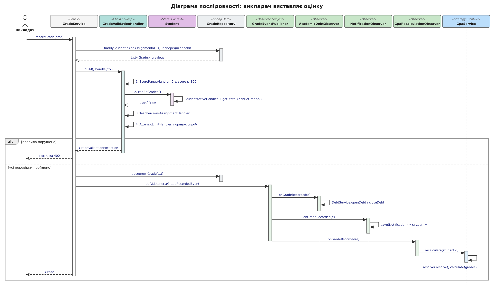
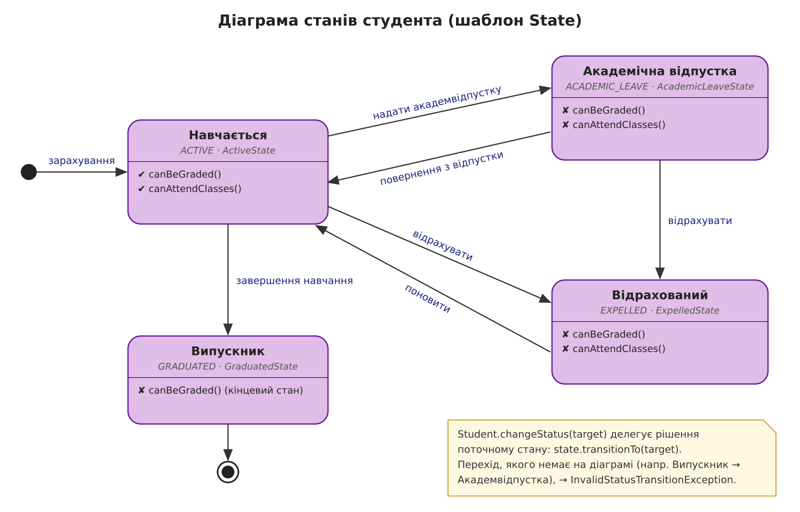
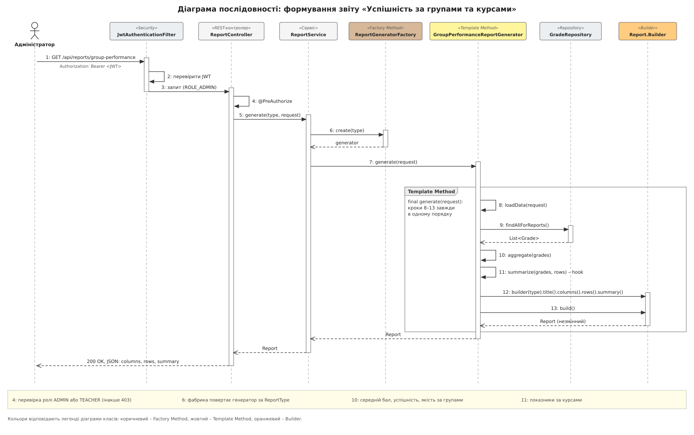

# Реалізація шаблонів проектування (бізнес-логіка)

Документ описує, як GoF-шаблони з [діаграми класів](02-class-diagram.md) реалізовано в коді бекенду
(етапи 3–4). Для кожного шаблону вказано проблему предметної області, учасників і тести.
Шаблони звітів (Template Method, Factory Method, Builder) додано на етапі 4 разом із REST API
([`04-rest-api.md`](04-rest-api.md)).

Пакети: `ua.lpnu.studentrecords.pattern.*` – класи шаблонів, `ua.lpnu.studentrecords.service` – сервіси,
які їх використовують, `ua.lpnu.studentrecords.domain.exception` – винятки бізнес-правил.

## Сценарій «викладач виставляє оцінку»



Один виклик `GradeService.recordGrade(cmd)` проходить через чотири шаблони:

1. **Chain of Responsibility** – запит перевіряють чотири обробники по черзі; перший, що знайшов
   порушення, кидає `GradeValidationException`, і оцінка не зберігається.
2. **State** – обробник `StudentActiveHandler` не перевіряє статус студента сам, а питає поточний стан
   (`student.canBeGraded()` → `ActiveState` / `ExpelledState` / …).
3. **Observer** – після збереження `GradeEventPublisher` сповіщає трьох спостерігачів: борги, сповіщення,
   середній бал. `GradeService` про них не знає.
4. **Strategy** – `GpaService` рахує середній бал стратегією, обраною адміністратором у налаштуваннях.

Якщо будь-який спостерігач завершиться помилкою, транзакція відкотиться разом з оцінкою – дані
(оцінка, борг, сповіщення) завжди узгоджені.

## Singleton – `GradingScale`

| | |
|---|---|
| Проблема | Переведення 100-бальної оцінки в національну шкалу та ЄКТС потрібне всюди (кабінет, відомість, звіти, сповіщення), а правила мають бути однаковими. |
| Рішення | `enum GradingScale { INSTANCE }` – єдиний екземпляр без змінного стану, потокобезпечний і захищений від копіювання через рефлексію/серіалізацію. |
| Методи | `toEcts(score)`, `toNational(score, controlType)`, `toFivePoint(score)`, `isPassing(score)`, `convert(...)` → `ScaleGrade` |
| Тести | `GradingScaleTest` – усі межі шкали ЄКТС, іспит / диф. залік / залік, недопустимі бали |

| Бали | ЄКТС | Іспит, диф. залік | Залік |
|---|---|---|---|
| 90–100 | A | відмінно | зараховано |
| 82–89 | B | добре | зараховано |
| 74–81 | C | добре | зараховано |
| 64–73 | D | задовільно | зараховано |
| 60–63 | E | задовільно | зараховано |
| 35–59 | FX | незадовільно | не зараховано |
| 0–34 | F | незадовільно | не зараховано |

## Strategy – розрахунок середнього балу

| Роль | Клас |
|---|---|
| Strategy | `GpaCalculationStrategy` – `BigDecimal calculate(List<Grade>)` |
| ConcreteStrategy | `SimpleAverageStrategy` – Σ бал / n; `CreditWeightedStrategy` – Σ (бал × кредити) / Σ кредити |
| Context | `GpaService` |
| Вибір стратегії | `GpaCalculationStrategyResolver` – читає налаштування `gpa.strategy` (`SIMPLE` / `CREDIT_WEIGHTED`) |

Для кожної дисципліни враховується лише підсумкова спроба – з найбільшим балом
(`FinalGradeSelector`), тобто незадовільна основна оцінка після успішного перескладання не псує
середній бал. Приклад з тесту: оцінки 90 (6 кредитів), 40 → 70 після перескладання (3 кредити),
81 (3 кредити) дають просте середнє **80.33** і зважене **82.75**.

Нову формулу (наприклад, рейтинг для стипендії) можна додати як ще один `@Component`, що реалізує
інтерфейс, – без змін у `GpaService` (принцип Open/Closed).
Тести: `GpaCalculationStrategyTest`, `GpaCalculationStrategyResolverTest`, `GpaServiceTest`.

## State – статус студента



| Роль | Клас |
|---|---|
| Context | `Student` – `getState()`, `changeStatus(target)`, `canBeGraded()` |
| State | `StudentState` – `canBeGraded()`, `canAttendClasses()`, `allowedTransitions()`, `transitionTo(target)` |
| ConcreteState | `ActiveState`, `AcademicLeaveState`, `ExpelledState`, `GraduatedState` |
| Фабрика станів | `StudentStateFactory.forStatus(status)` |

У БД зберігається лише статус (`student.status`), а об'єкт-стан відновлюється з нього фабрикою.
Стани не мають полів, тому кожен існує в одному екземплярі. Недопустимий перехід кидає
`InvalidStatusTransitionException`, який REST API (етап 4) перетворить на відповідь з описом помилки. Від стану залежить і розклад:
студент в академвідпустці отримує порожній розклад (`ScheduleService.getStudentSchedule`).
Тести: `StudentStateTest`, `StudentServiceTest`.

## Chain of Responsibility – валідація оцінки

| Порядок | Обробник | Правило |
|---|---|---|
| 1 | `ScoreRangeHandler` | бал заданий і в межах 0–100 |
| 2 | `StudentActiveHandler` | стан студента дозволяє оцінювання; студент навчається в групі, якій призначено дисципліну |
| 3 | `TeacherOwnsAssignmentHandler` | оцінку ставить викладач, який веде дисципліну в групі (запис адміністратора – без викладача – дозволено) |
| 4 | `AttemptLimitHandler` | порядок спроб: основна → перескладання викладачу → комісії, лише після незадовільної попередньої; складену дисципліну не переоцінюють |

Базовий клас `GradeValidationHandler` містить незмінний метод `handle(ctx)` («перевір себе → передай
далі») та абстрактний `check(ctx)`. Ланцюжок збирає `GradeValidationChainBuilder`; щоб додати правило
(наприклад, «оцінку можна поставити лише під час сесії»), достатньо нового обробника і одного рядка
в будівнику. Якщо спроба в команді не вказана, `GradeService` визначає її сам
(`AttemptLimitHandler.expectedAttempt`).
Тести: `GradeValidationChainTest`, `GradeServiceTest`.

## Observer – реакція на нову оцінку

| Роль | Клас | Дія |
|---|---|---|
| Subject | `GradeEventPublisher` | `subscribe`, `unsubscribe`, `notifyListeners(GradeRecordedEvent)` |
| Observer | `GradeEventListener` | `onGradeRecorded(event)` |
| ConcreteObserver | `AcademicDebtObserver` | < 60 балів – відкрити заборгованість, ≥ 60 – закрити відкриту (через `DebtService`) |
| ConcreteObserver | `NotificationObserver` | сповіщення студенту: «Нова оцінка з дисципліни «Бази даних»: 85 балів – добре (B).» |
| ConcreteObserver | `GpaRecalculationObserver` | перерахунок середнього балу через `GpaService` |

Spring впроваджує у конструктор видавця список усіх бінів `GradeEventListener`, тож новий спостерігач
підписується автоматично. Тести: `GradeEventPublisherTest`, `GradeObserversTest`,
`ApplicationContextTest` (перевіряє, що в контексті підписано всіх трьох спостерігачів).

## Facade – залікова книжка студента

`StudentRecordFacade.getRecord(studentId)` повертає `StudentRecordDto`: відомості про студента, усі оцінки
(з національною шкалою, ЄКТС і позначкою підсумкової спроби), середній бал, заборгованості та розклад.
Фасад приховує п'ять підсистем (`StudentService`, `GradeService`, `GpaService`, `DebtService`,
`ScheduleService`) і `GradingScale`; клієнт (REST-контролер кабінету студента) робить один виклик,
а дані читаються в одній транзакції. Тести: `StudentRecordFacadeTest`.

## Перевірка конфліктів розкладу

`ScheduleConflictChecker` порівнює нове заняття із заняттями в той самий день і пару:

- **викладач** уже веде інше заняття;
- **аудиторія** вже зайнята;
- **група** вже має заняття.

Чисельник (`ODD`) і знаменник (`EVEN`) не перетинаються між собою, а «щотижня» (`ALL`) перетинається
з обома. Потокова лекція (одна дисципліна, той самий викладач і аудиторія для кількох груп) конфліктом
не вважається. `ScheduleService.create` не зберігає заняття з конфліктами і кидає
`ScheduleConflictException` зі списком усіх знайдених конфліктів – їх покаже конструктор розкладу
(етап 6). Тести: `ScheduleConflictCheckerTest`, `ScheduleServiceTest`.

## Template Method – генератори звітів

| | |
|---|---|
| Проблема | Три звіти (успішність груп, статистика викладачів, заборгованості) мають однаковий алгоритм: завантажити дані з фільтрами → згрупувати й порахувати → підсумки → зібрати звіт. Відрізняються лише окремі кроки. |
| AbstractClass | `AbstractReportGenerator<D>` – `public final Report generate(ReportRequest)` |
| Кроки (primitive operations) | `loadData(request)`, `aggregate(data, request)`, `columns()` – абстрактні |
| Гачки (hooks) | `summarize(data, rows)` – за замовчуванням порожні підсумки; `title(request)` – назва типу + навчальний рік |
| ConcreteClass | `GroupPerformanceReportGenerator`, `TeacherStatisticsReportGenerator`, `AcademicDebtReportGenerator` |
| Тести | `ReportGeneratorsTest` – порядок викликів кроків, розрахунки кожного звіту, фільтри |

Метод `generate` оголошено `final`, тому підклас не може змінити послідовність кроків чи забути
зібрати звіт через Builder. Генератори – звичайні Spring-біни без `@Transactional`: CGLIB-проксі не
перехоплює `final`-методи, тому транзакцію (лише читання) відкриває `ReportService`.

```java
public final Report generate(ReportRequest request) {
    ReportRequest effective = request != null ? request : ReportRequest.empty();
    D data = loadData(effective);                                   // крок 1
    List<Map<String, Object>> rows = aggregate(data, effective);    // крок 2
    Map<String, Object> summary = summarize(data, rows);            // гачок
    return Report.builder(type()).title(title(effective))           // крок 3 – Builder
            .columns(columns()).rows(rows).summary(summary).build();
}
```

## Factory Method – вибір генератора звіту

`ReportGeneratorFactory.create(ReportType)` повертає потрібний генератор як абстракцію
`AbstractReportGenerator<?>`. Контролер і `ReportService` не знають конкретних класів: тип звіту
приходить з URL (`/api/reports/teacher-statistics` → `ReportType.TEACHER_STATISTICS`), а фабрика
обирає реалізацію. Конкретні генератори Spring передає у конструктор фабрики списком, фабрика
реєструє їх у `EnumMap` за `type()` і не дозволяє двох генераторів одного типу. Новий звіт = новий
підклас з `@Component` і нове значення `ReportType`; фабрика і клієнти не змінюються (OCP).
Тести: `ReportGeneratorFactoryTest`.

## Builder – незмінний звіт

`Report` має сім частин (тип, заголовок, час, параметри, колонки, рядки, підсумки). Генератор заповнює
їх поступово через `Report.builder(type)`, а `build()`:

- перевіряє, що є заголовок і хоча б одна колонка, ключі колонок не повторюються, а рядки не містять
  невідомих колонок;
- робить захисні копії колекцій і повертає **незмінний** об'єкт (зміни будівельника чи вихідних мап
  після `build()` не впливають на звіт).

Тести: `ReportBuilderTest`. Діаграма послідовності всього сценарію:



## Запуск тестів

```bash
cd backend
mvn test
```

Модульні тести шаблонів не потребують БД (JUnit 5 + Mockito). `ApplicationContextTest` і
`SecuredApiTest` піднімають контекст Spring на вбудованій H2 (профіль `test`,
`src/test/resources/application-test.yml`).
`DatabaseMigrationTest` виконується лише в CI на PostgreSQL (`CI_POSTGRES=true`).
